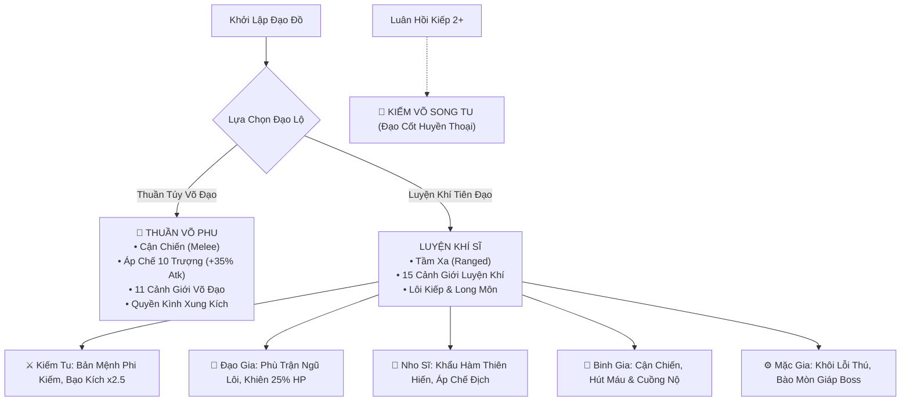
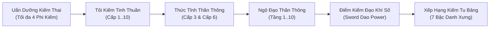

# HƯỚNG DẪN KIẾN TRÚC & HỆ THỐNG GAME KIẾM LAI · TU TIÊN KÝ
> **Dự án**: Kiếm Lai · Tu Tiên Ký (`tu-tien-ky`)  
> **Phiên bản tài liệu**: 2.1 (Đồng bộ Save v11 & Hệ Thống Phi Kiếm Bản Mệnh Kiếm Lai)  
> **Cập nhật ngày**: 29/10/2026  
> **Tác giả**: Multi-Agent Architecture Team (`meth`)

---

## ☯️ I. HỆ THỐNG CẢNH GIỚI TU HÀNH (DUAL CULTIVATION SYSTEM)

Hệ thống cho phép người chơi lựa chọn đi theo một trong hai đại đạo lộ độc lập hoàn toàn, hoặc hợp nhất qua luân hồi:

### 1. Thuần Túy Võ Đạo (11 Cảnh Giới Võ Đạo)
Con đường nghịch thiên tự cường của Trần Bình An. Võ phu tôi luyện thể phách kim cương, tích lũy Quyền Lực và uẩn dưỡng Hám Sơn Quyền Ý.

| Bậc Cảnh Giới | Tên Cảnh Giới | Số Quyền Tối Thiểu | Đặc Điểm & Ý Nghĩa Lore Kiếm Lai |
| :--- | :--- | :--- | :--- |
| **Luyện Thể Tam Cảnh** | 1. Nê Phôi Cảnh | 0 quyền | Nhục thân như bùn đất lò gốm, bắt đầu gọt giũa kình lực. |
| | 2. Mộc Thai Cảnh | 50 quyền | Gân cốt vững chắc như cây già ngàn năm, xuất quyền có tiếng gió rít. |
| | 3. Thủy Ngân Cảnh | 200 quyền | Khí huyết cô đọng chảy cuồn cuộn như thủy ngân, vượt khảo nghiệm *Ni Bồ Tát Quá Giang*. |
| **Luyện Khí Tam Cảnh** | 4. Anh Hồn Cảnh | 600 quyền | Hơi thở ngưng tụ anh hồn, quyền ý câu thông sinh tử. |
| | 5. Hùng Phách Cảnh | 1.500 quyền | Phách lực hùng hậu, khí thế áp đảo tà ma ngoại đạo. |
| | 6. Võ Đảm Cảnh | 3.500 quyền | Đúc thành võ đảm kiên cường, đối diện cường địch trời đất không chút dao động. |
| **Luyện Thần Tam Cảnh** | 7. Kim Thân Cảnh | 8.000 quyền | Đúc thành Kim Thân bất hoại, đao kiếm phàm tục chém vào như gãi ngứa. |
| | 8. Viễn Du Cảnh | 18.000 quyền | Thần du vạn dặm, quyền phong vượt ngàn dặm chấn động sơn hà. |
| | 9. Sơn Điên Cảnh | 40.000 quyền | Đứng trên đỉnh núi nhìn xuống nhân gian, võ đạo chín tầng viên mãn. |
| **Đỉnh Cao Võ Đạo** | 10. Chỉ Cảnh (Quy Chân) | 80.000 quyền | Võ phu thập cảnh chí tôn, sánh ngang đại tu sĩ Thượng Ngũ Cảnh. |
| | 11. Võ Thần Cảnh | 150.000 quyền | Vô địch thiên hạ, một quyền phá vạn pháp, trường sinh cùng nhật nguyệt! |

> [!NOTE]
> **Quy Tắc Đột Phá Võ Đạo**: Võ phu không cướp đoạt thiên địa linh khí, do đó **miễn nhiễm 100% với Lôi Kiếp Thiên Phạt**! Khi số quyền tích lũy đạt mốc, người chơi có thể tiến hành đột phá thành công ngay lập tức.

---

### 2. Luyện Khí Tiên Đạo (15 Cảnh Giới Luyện Khí Sĩ)
Hệ thống tu đạo thuận thiên ứng nhân, cướp đoạt tạo hóa trời đất, chia làm 15 Đại Cảnh Giới (43 tầng):

1. **Hạ Ngũ Cảnh (Giai đoạn Leo Núi)**:
   - *Đồng Bì Cảnh*: Rèn da đồng, giảm sát thương vật lý cơ bản.
   - *Thảo Căn Cảnh*: Rễ cỏ sinh sôi, tăng tốc độ hồi phục sinh lực.
   - *Liễu Cân Cảnh*: Tôi luyện gân cốt như cành liễu dẻo dai (Lưu Nhân Cảnh).
   - *Khí Cốt Cảnh*: Xương cốt ngàn cân, làm nền tảng cho khí phủ.
   - *Trúc Thể Cảnh*: Lấy thân thể làm lò luyện khí (Trúc Lô).
2. **Trung Ngũ Cảnh (Địa Tiên Nhân Gian)**:
   - *Động Phủ Cảnh*: Khai mở các khiếu huyệt như tiểu động thiên trong cơ thể.
   - *Quan Hải Cảnh*: Kinh mạch mở rộng mênh mông như biển lớn.
   - *Long Môn Cảnh*: Cửa ải sinh tử, cá chép vượt Vũ Môn hóa rồng.
   - *Kim Đan Cảnh*: Kết Đan thất, Kiếm Tu bắt đầu uẩn dưỡng Bản Mệnh Phi Kiếm hoàn chỉnh.
   - *Nguyên Anh Cảnh*: Âm Thần / Dương Thần xuất khiếu chu du thiên hạ.
3. **Thượng Ngũ Cảnh & Thất Truyền (Tiên Nhân / Hợp Đạo)**:
   - *Ngọc Phác Cảnh*: Thân thể lưu ly vô cấu, miễn nhiễm tà khí độc tố.
   - *Tiên Nhân Cảnh*: Tích lũy khí số nhân gian hoặc công đức tông môn.
   - *Phi Thăng Cảnh*: Đỉnh cao nhân gian, chạm tới ngưỡng cửa thiên môn.
   - *Thập Tứ Cảnh*: Hợp Đạo trời đất (Thiên Thời, Địa Lợi, Nhân Hòa).
   - *Thập Ngũ Cảnh*: Tuyệt đỉnh cửu châu, chưởng quản đại đạo càn khôn.

---

## ⚔️ II. LỤC ĐẠI HỆ PHÁI & CƠ CHẾ CHIẾN ĐẤU CẬN CHIẾN - TẦM XA



### 1. Phân Định Chiến Đấu Cận Chiến (Melee) vs Tầm Xa (Ranged)

| Tiêu Chí | Cận Chiến (Võ Phu, Binh Gia, Phật Môn) | Tầm Xa (Kiếm Tu, Đạo Gia, Nho Sĩ, Mặc Gia) |
| :--- | :--- | :--- |
| **Vị trí & Hoạt ảnh** | **Lướt áp sát (`journey-melee-rush`)**: Hero lướt thần tốc từ `left: 12%` đến sát quái `left: 55% - 62%`, tung đòn giáp lá cà cự ly gần. | **Trấn thủ trận địa (`journey-breathe`)**: Hero đứng vững tại chỗ ở `left: 12%`, tà áo bay nhẹ, hai tay bấm quyết. |
| **Hiệu ứng ra đòn** | **Quyền kình sóng xung kích (`punch-impact-ring`)**: Vòng năng lượng Khí Huyết nổ tung trực tiếp trên thân thể quái vật. **Tuyệt đối không rung giật màn hình**. | **Tia đạn đạo phóng xuất (`flying-sword-bolt`)**: Tia Bản Mệnh Phi Kiếm hoàng kim bay vút xé gió qua không gian cắm vào quái vật. |
| **Cơ chế độc bản** | **Áp Chế 10 Trượng**: Công thức $M_{\text{Martial}} = 1 + 0.35 \times (1 - d/10)$. Khi áp sát $d=0$ trượng, nhận trọn vẹn **+35% tổng sát thương**! | **Đạn đạo xuyên thấu**: Tỉ lệ bạo kích cao, khả năng khống chế và debuff quái vật từ xa an toàn. |

---

## 💾 III. KIẾN TRÚC LƯU TRỮ (SAVE V10) & ZERO DATA LOSS

Cấu trúc `GameState` được chuẩn hóa qua Zod schema (`src/engine/save/schema.ts`):
```typescript
export interface GameState {
  version: 10
  createdAt: number
  lastSavedAt: number
  playedMs: number
  classId: ClassId                        // 'kiem-tu' | 'vo-phu' | 'dao-gia' | 'nho-gia'...
  cultivationPath: 'martial' | 'qi' | 'dual' // Đạo đồ khởi đầu
  martialStageIndex: number               // Cảnh giới võ đạo hiện tại (0..10)
  punches: number                         // Số quyền tích lũy
  realmIndex: number                      // Index cảnh giới Luyện Khí Sĩ (0..39)
  qi: number                              // Linh khí
  stones: number                          // Linh thạch tiền tệ
  // ...
}
```

### Chuỗi Migration v9 $\rightarrow$ v10:
- Tự động nhận diện nếu save cũ đang ở `classId === 'vo-phu'` thì gán `cultivationPath = 'martial'`, ngược lại là `'qi'`.
- Tự động tính toán số quyền đã luyện (`punches`) dựa trên số lượng quái và boss người chơi đã tiêu diệt trong quá khứ:
  $$\text{punches} = \text{enemiesSlain} + \text{bossesSlain} \times 10 + \text{stagesCleared} \times 5$$
- Đảm bảo người chơi cũ nâng cấp lên bản mới không bao giờ bị mất đồ, mất cấp hay kẹt game.

---

## 🎒 IV. HỆ THỐNG RƠI ĐỒ HÀNH TẨU & TIỀN TỆ KIẾM LAI

Phiên bản đại tu chiến lợi phẩm hành tẩu giúp người chơi không còn cảm giác nhàm chán khi farm ải:

1. **Tiền Thần Tiên Kiếm Lai**:
   - **Tuyết Hoa Tiền (雪花钱)**: Rơi từ quái và boss. Mỗi đồng đổi được **1.000 Linh Thạch**.
   - **Tiểu Thử Tiền (小暑钱)**: Rơi từ Boss vùng cao/độ khó cao. Mỗi đồng đổi được **100.000 Linh Thạch**.
   - **Cốc Vũ Tiền (谷雨钱)**: Cực phẩm rơi từ Boss Viễn Cổ. Mỗi đồng đổi được **10.000.000 Linh Thạch**.
   - Có thể đổi trực tiếp ra Linh Thạch trong Túi Càn Khôn.

2. **Dược Liệu & Yêu Đan Đa Dạng**:
   - Yêu Đan Hạ / Trung / Thượng Phẩm rơi theo cấp độ quái và cõi giới.
   - Thảo dược quý theo vùng: *Hỏa Diệm Thảo (Hoang Dã), Huyền Băng Hoa (Lạc Phách Sơn), Kiếm Ý Thảo & Kiếm Khí Tinh Thạch (Kiếm Khí Trường Thành), Thủy Tinh Châu (Thư Giản Hồ)...*

3. **Sách Thần Thông & Tàn Quyển Bí Tịch Rơi Độc Quyền**:
   - Boss và quái tinh anh các cõi có cơ hội rớt các bộ bí kíp thất truyền: *Sơ Thập Kiếm Phổ*, *Thập Cửu Quyền Phổ*, *Ngũ Lôi Đạo Chân Quyết*, *Bách Thảo Bí Yếu*.
   - Người chơi bấm **"Lĩnh Ngộ"** trong Túi Càn Khôn để mở khóa hoặc tăng cấp công pháp mà không tốn Linh Thạch.

4. **Hiệu Ứng Thị Giác Sống Động**:
   - Chữ vàng bay lên trên sàn đấu khi quái chết (`🪙 +Linh Thạch`, `🌿 +Thảo Dược`, `📜 [Bí Tịch]!`).
   - Bảng **Chiến Lợi Phẩm Hành Tẩu** tích hợp ngay dưới màn hình Hành Tẩu.

---

## 🗡️ VI. HỆ THỐNG PHI KIẾM BẢN MỆNH & KIẾM TU BẢNG

Dành riêng cho phái **Kiếm Tu** (hoặc sau khi giác ngộ Kiếm Đạo), hệ thống mô phỏng chân thực khí phủ uẩn dưỡng kiếm thai trong tiểu thuyết Kiếm Lai:



### 1. Danh Sách 6 Phi Kiếm Bản Mệnh Kiếm Lai
| Tên Phi Kiếm | Đạo Uẩn & Ngũ Hành | Cảnh Giới Yêu Cầu | Điển Tích & Nguồn Gốc Lore | Thần Thông Mặc Định & Thức Tỉnh |
| :--- | :--- | :--- | :--- | :--- |
| **Sơ Thập (初十)** | Thuần Dương Phong Lôi | Đồng Bì Cảnh (Cấp 0) | Sợi tơ vàng rực thai nghén trong lò rồng trấn nhỏ của Trần Bình An, tốc độ xé rách hư không. | • *Bôn Lôi Tật Hành* (Tốc đánh +10%..30%)<br/>• Cấp 3: *Phá Không Sát Giáp* (Xuyên giáp 15%..45%) |
| **Thập Ngũ (十五)** | Trầm Trọng Sơn Nhạc | Khí Cốt Cảnh | Phi kiếm màu mực thẫm nặng tựa Thái Sơn, uy áp vạn dặm. | • *Thiên Quân Áp Đỉnh* (Sát thương nặng theo % HP địch)<br/>• Cấp 3: *Khí Phủ Uẩn Khí* (Tăng tốc nạp linh khí) |
| **Tỉnh Để (井底)** | Hư Không Cấm Giới | Trúc Thể Cảnh | Sinh ra từ đạo tâm "Tọa tỉnh quan thiên", phong tỏa chiến trường. | • *Tọa Tỉnh Cấm Giới* (Giảm sát thương nhận vào 10%..30%)<br/>• Cấp 3: *Kính Hoa Thủy Nguyệt* (Né tránh đòn 10%..28%) |
| **Mạch Thượng (陌上)**| Trường Xuân Mộc Ý | Động Phủ Cảnh | Mộc linh tràn trề sinh cơ, chuyển sát thương thành huyết dịch. | • *Xuân Phong Hóa Vũ* (Hút máu 8%..26%)<br/>• Cấp 3: *Bôn Lôi Tật Hành* |
| **Ánh Tuyết (映雪)** | Cực Hàn Băng Sương | Quan Hải Cảnh | Rèn từ tuyết ngàn năm Bắc Câu Lô Châu, buốt lạnh thấu tâm can. | • *Băng Phách Tuyết Hồn* (Bạo kích +12%..37%)<br/>• Cấp 3: *Phá Không Sát Giáp* |
| **Huyền Hoàng Trảm Tiên (玄黄斩仙)** | Hồng Hoang Viễn Cổ | Kim Đan Cảnh | Rèn từ máu đại yêu trên Kiếm Khí Trường Thành, vô địch sát phạt. | • *Nhất Kiếm Phá Vạn Pháp* (Tổng sát thương +25%..75%)<br/>• Cấp 3: *Tuyệt Cảnh Trảm Thần* (Hành quyết boss < 15% HP) |

### 2. Thức Tỉnh & Đa Thần Thông Trên Mỗi Phi Kiếm
- Mỗi phi kiếm khi uẩn dưỡng sẽ sở hữu ngay **1 Thần Thông Bản Mệnh sơ khởi**.
- Khi người chơi dùng Linh Thạch **Tôi Kiếm** lên **Cấp 3** và **Cấp 6**, kiếm ý viên mãn sẽ tự động **Thức Tỉnh thêm Thần Thông mới**.
- Người chơi có thể tiêu hao linh thạch để **Ngộ Đạo** thăng tầng (Tầng 1 $\rightarrow$ 10) cho từng Thần Thông, gia tăng mạnh mẽ các chỉ số chiến đấu độc bản (xuyên giáp, bạo kích, hút máu, né tránh, sát thương nặng, trảm sát hành quyết).

### 3. Xếp Hạng Kiếm Tu Bảng Thiên Hạ (7 Bậc Danh Xưng)
Dựa trên công thức tính **Kiếm Đạo Khí Số**:
$$\text{Power} = \sum (\text{Tier}_{\text{Kiếm}} \times 100 + \text{Level} \times 25) + \sum (\text{Tier}_{\text{Thần Thông}} \times 50 + \text{Level} \times 15)$$

| Bậc | Danh Hiệu Kiếm Tu Bảng | Điều Kiện Số Kiếm & Khí Số | Đặc Quyền Gia Trì Chiến Lực |
| :---: | :--- | :--- | :--- |
| **1** | **Kiếm Đồ Sơ Khởi** | 0 Kiếm, 0 điểm | Mới bước chân vào kiếm đạo, kiếm ý còn sơ khai. |
| **2** | **Khí Phủ Kiếm Sĩ** | $\ge 1$ Kiếm, $\ge 150$ điểm | +5% Tổng Sát Thương Công Kích. |
| **3** | **Trảm Cương Kiếm Hiệp** | $\ge 1$ Kiếm, $\ge 350$ điểm | +10% Sát Thương, +5% Tốc Độ Ra Đòn. |
| **4** | **Song Tuyệt Kiếm Tiên** | $\ge 2$ Kiếm, $\ge 700$ điểm | +20% Sát Thương, +10% Tỷ Lệ Bạo Kích. |
| **5** | **Tam Kiếm Đại Kiếm Tiên**| $\ge 3$ Kiếm, $\ge 1.200$ điểm | +30% Sát Thương, +15% Xuyên Giáp Bỏ Qua Phòng Ngự. |
| **6** | **Ẩn Quan Kiếm Tôn** | $\ge 3$ Kiếm, $\ge 2.000$ điểm | +45% Sát Thương, +20% Bạo Kích. (Danh hiệu Trưởng quan Kiếm Khí Trường Thành). |
| **7** | **Thập Tứ Cảnh Tuyệt Đỉnh Kiếm Tiên** | 4 Kiếm Viên Mãn, $\ge 3.000$ điểm | +70% Sát Thương, +30% Xuyên Giáp Tuyệt Đối! |

---

## 🧪 VII. QUY TRÌNH KIỂM THỬ & GIÁM SÁT HIỆU NĂNG

Mọi thay đổi trong codebase phải vượt qua bộ kiểm thử tự động Vitest:
- `tests/migration.test.ts`: Kiểm tra toàn vẹn chuỗi nâng cấp save từ v1 đến v11 (Save v11 Migration an toàn tuyệt đối).
- `tests/natalSwords.test.ts`: Kiểm tra toàn bộ cơ chế uẩn dưỡng phi kiếm, tôi kiếm cấp 1..10, thức tỉnh thần thông cấp 3, ngộ đạo và xếp hạng Kiếm Tu Bảng.
- `tests/cultivationPath.test.ts`: Kiểm tra logic phân nhánh Võ Phu vs Luyện Khí Sĩ và công thức áp chế 10 trượng.
- `tests/journeyLoot.test.ts`: Kiểm tra cơ chế rơi tiền thần tiên, yêu đan, tàn quyển bí kíp.
- `tests/sim.test.ts`: Giả lập bot 24h chạy liên tục, đảm bảo tiến trình cân bằng và không bị lạm phát chỉ số (Power Creep).

```bash
pnpm test       # Chạy 34 test suites (173 tests pass 100%)
pnpm lint       # Kiểm tra 0 lỗi ESLint
pnpm build      # Kiểm tra type-check TypeScript và build PWA
```

---
*Tài liệu nội bộ dự án Kiếm Lai · Tu Tiên Ký.*
